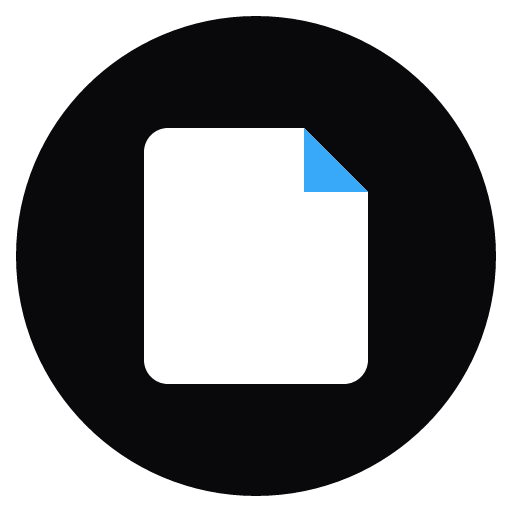

<p align="center"></p>
<h1 align="center">Moyu</h1>
<p align="center"><strong>Your manga, your own library.</strong></p>
<p align="center">A local-first desktop manga reader for Windows and Linux.</p>
<p align="center"><a href="README.md">简体中文</a> · English</p>
<p align="center"><a href="https://github.com/D-OneXXX/Moyu/releases"><strong>Download Moyu ↗</strong></a> · <a href="#getting-started">Get started</a> · <a href="https://github.com/D-OneXXX/Moyu/issues">Support ↗</a></p>
<p align="center"><br><sub>Real development-build screenshot using an isolated library and AI-generated sample comics.</sub></p>

## Made for reading

- **Keep a local library.** Organize image folders, ZIP, CBZ, and local PDF documents. No account or cloud library is required.
- **Read your way.** Choose single-page, double-page, or continuous webtoon layouts, adjust the reading direction, and pick a light or dark theme. PDFs use a single-page layout.
- **Pick up where you left off.** Moyu remembers reading progress and can preserve it when you relocate a moved local source.
- **Read online on your terms.** Open supported online pages or browse public Telegram channels. Moyu does not bundle manga sources.

## Demo comics

[Interactive HTML demo](public/demo/index.html) · [page preview](docs/assets/screenshots/demo-site.png) — open this file in a browser after downloading the repository. Current source builds also provide an entry in Settings → About & maintenance.


Try four AI-generated sample comics. Each of the first three has a cover and one story page; the science-fiction comic has a cover and four story pages. Download a CBZ and import it into your library.

- [Sky Station and the Mechanical Bird](public/demo/assets/sky-station.cbz) — black-and-white manga.
- [Rainy Day Café](public/demo/assets/rain-cafe.cbz) — a vertical color webtoon.
- [Orbital Greenhouse](public/demo/assets/orbital-garden.cbz) — a color comic page.
- [Echoes of Europa](public/demo/assets/europa-echo.cbz) — a realistic science-fiction comic with four story pages.

These samples are for demonstration and do not represent a built-in manga catalog.

## Download

Get the available packages from [GitHub Releases](https://github.com/D-OneXXX/Moyu/releases). Windows x64 uses an NSIS installer; Linux x86_64 offers DEB, RPM and AppImage packages. Windows and Linux releases are maintained separately. macOS and ARM64 builds are not currently provided.

The Windows installer is not Authenticode-signed, so SmartScreen may warn you. Verify that it came from this repository's Releases page. Updater packages use a separate signature. Update DEB and RPM installations through your package manager; AppImage can use the in-app updater.

## Getting started

1. Download and install the package for your system.
2. Select **Add folder** or **Add books** to import your files.
3. Open a book and choose a reading layout. Moyu remembers your progress.

Encrypted PDFs are not supported. Use only content and online sources you are authorized to access.

## Privacy and backup

Your library data and progress stay on your machine. Local reading does not upload your library; network features such as online reading and update checks make the necessary requests. Session request headers can be kept in memory only; global request-header settings are user-managed persistent preferences.

A `.mrbackup` contains library records, progress, statistics and selected preferences, but does **not** contain your comic files, image caches, or online request headers. Copy your source files separately and relocate them if necessary.

The main branch can contain features that are not yet in a public release, including local-network reading and self-hosted OPDS libraries. Check the release notes for your platform. Some installer names and data directories retain the legacy MangaReader identity for upgrade compatibility.

<a id="development"></a>
## Development

Requirements: Node.js 22+, stable Rust, platform-specific Tauri 2 build dependencies, and WebView2 on Windows.

```bash
npm install
npm run tauri dev
npm run build
```

```bash
npx tsc --noEmit
cargo test --lib --manifest-path src-tauri/Cargo.toml
node tests/qa/run-qa.mjs --suite=static
```

`tauri dev` opens a desktop window. The full QA suite may also control a visible application window; see [architecture](docs/ARCHITECTURE.md) and the project testing guidance before running it.

## Support and license

Report bugs and suggestions in [GitHub Issues](https://github.com/D-OneXXX/Moyu/issues); report security vulnerabilities privately through [Security Advisories](https://github.com/D-OneXXX/Moyu/security/advisories/new). Remove personal paths, titles, cookies, tokens and full URLs from shared logs or screenshots.

Moyu is source-available under the [PolyForm Noncommercial License 1.0.0](LICENSE), for personal and other noncommercial use. It is not OSI-approved open source; commercial use is not granted. See [NOTICE](NOTICE.md) and [third-party notices](THIRD_PARTY_NOTICES.md).
